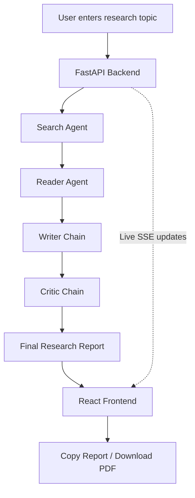

# Multi-Agent Research Assistant

**Research that goes beyond the first answer.**

An AI-powered research application that transforms a topic into a structured, critically reviewed research report. It combines web search, content extraction, LLM-powered report generation and AI-based evaluation in a sequential research pipeline.

[View Repository](https://github.com/prakhar-tripathi182/multi-agent-system)

---

## Overview

Finding information online is easy. Turning it into a coherent, well-structured and critically evaluated research report is considerably harder.

The Multi-Agent Research Assistant addresses this through a sequential AI-powered workflow. Given a research topic, the application retrieves relevant web results, extracts source content, generates a structured report and evaluates the final output.

The application provides live pipeline progress through Server-Sent Events (SSE), allowing users to follow each stage as it executes.

## Features

- **Automated Web Research:** Retrieves relevant information using Tavily Search.
- **Content Extraction:** Selects a relevant search result and extracts its webpage content.
- **AI Report Generation:** Produces structured research reports using Groq-hosted language models.
- **AI Critique:** Evaluates the generated report and provides feedback with a numerical score.
- **Live Progress Tracking:** Streams research-stage updates to the frontend using SSE.
- **PDF Export:** Downloads the generated report and critic review as a formatted PDF.
- **Copy Report:** Copies the generated Markdown report to the clipboard.
- **Research Metadata:** Displays the topic, completion time, retrieved source count and critic score.
- **Rerun Research:** Runs the pipeline again without requiring the user to re-enter the topic.
- **Security Measures:** Includes URL validation, SSRF protections, redirect validation and basic API rate limiting.

## How It Works

The application follows a sequential research workflow consisting of four stages.



### Research Pipeline

| Stage | Component | Responsibility |
|---|---|---|
| 01 | Search Agent | Searches the web using Tavily and retrieves relevant results. |
| 02 | Reader Agent | Selects a relevant result and extracts webpage content. |
| 03 | Writer Chain | Generates a structured research report using the collected information. |
| 04 | Critic Chain | Reviews the generated report, evaluates its quality and assigns a score. |

**Note:** The implementation uses two tool-using LangChain agents (Search and Reader) and two LLM chains (Writer and Critic). The four stages are orchestrated sequentially rather than operating as four independent autonomous agents.

## Technology Stack

### Backend

- Python
- FastAPI
- LangChain
- LangChain Groq
- Groq API — `openai/gpt-oss-20b`
- Tavily Search API
- BeautifulSoup4
- Requests
- Server-Sent Events (SSE)

### Frontend

- React
- Vite
- JavaScript
- CSS
- React Markdown

### PDF Generation

- Python-Markdown
- xhtml2pdf

## Application Architecture

```text
multi-agent-research-assistant/
│
├── main.py
├── agents.py
├── tools.py
├── pipeline.py
├── streaming_pipeline.py
├── pdf_generator.py
│
├── requirements.txt
├── .env.example
├── .gitignore
│
└── frontend/
    ├── src/
    │   ├── App.jsx
    │   ├── components/
    │   └── ...
    │
    ├── public/
    │   └── fonts/
    │
    ├── package.json
    ├── package-lock.json
    └── .env.example
```

### Important Backend Modules

| File | Description |
|---|---|
| `main.py` | FastAPI application, API endpoints, SSE streaming and rate limiting. |
| `agents.py` | Defines the Search and Reader agents, Writer chain and Critic chain. |
| `tools.py` | Implements Tavily search, webpage extraction and URL security validation. |
| `pipeline.py` | Executes the complete sequential research pipeline. |
| `streaming_pipeline.py` | Executes the research workflow while yielding intermediate stage updates. |
| `pdf_generator.py` | Converts research reports and critic reviews into downloadable PDFs. |

## API Endpoints

| Method | Endpoint | Description |
|---|---|---|
| GET | `/research?topic=...` | Starts research and streams progress through SSE. |
| POST | `/download-pdf` | Generates and returns a downloadable PDF. |

### Research Streaming

The `/research` endpoint uses Server-Sent Events to communicate pipeline progress to the frontend.

The frontend receives updates as the following stages execute:

1. Search
2. Reader
3. Writer
4. Critic
5. Pipeline completion or error

This allows the interface to display live progress without requiring WebSockets.

### PDF Download

The `/download-pdf` endpoint accepts the research topic, generated report and critic review, then returns a formatted PDF document.

The PDF is generated from the existing research results without executing the research pipeline again.

## Getting Started

Follow these instructions to run the application locally.

### Prerequisites

- Python 3.12
- Node.js and npm
- Groq API key
- Tavily API key

### 1. Clone the Repository

```bash
git clone https://github.com/prakhar-tripathi182/multi-agent-system.git

cd multi-agent-system
```

### 2. Set Up the Backend

Create and activate a Python virtual environment.

**Windows PowerShell:**

```powershell
python -m venv .venv

.\.venv\Scripts\Activate.ps1
```

Install the required dependencies:

```powershell
pip install -r requirements.txt
```

### 3. Configure Environment Variables

Create a `.env` file in the project root:

```powershell
Copy-Item .env.example .env
```

Add your API credentials:

```env
GROQ_API_KEY=your_groq_api_key
TAVILY_API_KEY=your_tavily_api_key

ALLOWED_ORIGINS=http://localhost:5173,http://127.0.0.1:5173

RESEARCH_RATE_LIMIT=5
PDF_RATE_LIMIT=15
RATE_LIMIT_WINDOW_SECONDS=60

TRUST_PROXY=false
```

Replace the placeholder API credentials with your own.

Do not commit your `.env` file or expose API credentials publicly.

### 4. Start the Backend

From the project root, run:

```powershell
uvicorn main:app --reload
```

The backend will be available at:

```text
http://localhost:8000
```

FastAPI documentation:

```text
http://localhost:8000/docs
```

### 5. Set Up the Frontend

Open a second terminal:

```powershell
cd frontend
```

Install dependencies:

```powershell
npm install
```

Create the frontend environment file:

```powershell
Copy-Item .env.example .env
```

Configure the backend URL in `frontend/.env`:

```env
VITE_API_URL=http://localhost:8000
```

### 6. Start the Frontend

Run:

```powershell
npm run dev
```

Open the application in your browser:

```text
http://localhost:5173
```

You can now enter a research topic and start generating reports.

## Security and Reliability

The application includes several basic security and reliability measures:

- **SSRF Protection:** Validates target URLs and resolved IP addresses before webpage requests.
- **Redirect Validation:** Revalidates redirect destinations to prevent redirects to private or internal addresses.
- **DNS-Rebinding Mitigation:** Pins validated public IP addresses for outgoing webpage requests.
- **API Rate Limiting:** Applies configurable per-client request limits to research and PDF endpoints.
- **Input Validation:** Rejects empty research topics and invalid PDF requests.
- **Restricted CORS:** Allows explicitly configured frontend origins.
- **Environment Variables:** Keeps API credentials outside the source code.

**Deployment consideration:** Rate limiting currently uses in-memory storage. Limits are maintained separately by each application process and reset when the process restarts. Multi-worker or multi-instance deployments require a shared rate-limiting solution for consistent enforcement.

## Current Limitations

- Research quality depends on the relevance and availability of web search results.
- Some websites restrict automated scraping or require JavaScript rendering.
- The Reader Agent processes selected webpage content rather than comprehensively analysing every search result.
- LLM-generated reports and critic scores should not be treated as guarantees of factual accuracy.
- In-memory rate limiting is intended for lightweight deployment and demonstration rather than large-scale multi-instance hosting.
